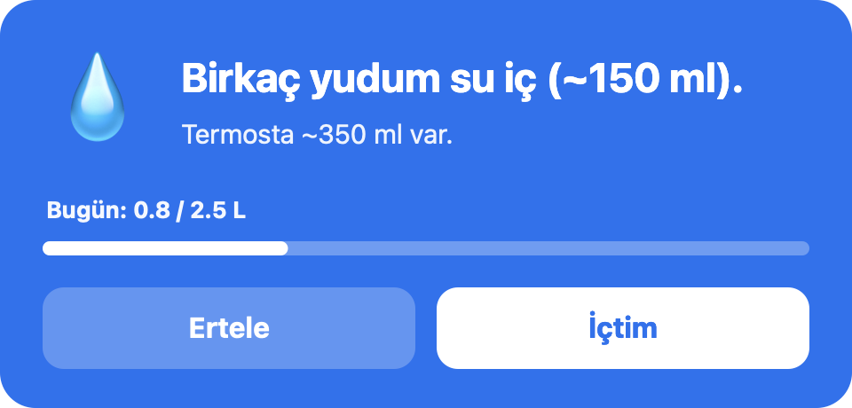

# 💧 Water Reminder

[](https://github.com/hamzakabakcili-ui/water-reminder/actions/workflows/ci.yml)


A lightweight macOS reminder that nudges you to drink water and refill your thermos during the workday. No dependencies, no accounts, everything runs locally.

**Hafta içi mesai boyunca su içmeyi ve termosu doldurmayı hatırlatan, tamamen yerel çalışan küçük bir macOS uygulaması.**

<p align="center">
  
</p>

## Quick start (English)

```bash
git clone https://github.com/hamzakabakcili-ui/water-reminder.git
cd water-reminder
python3 su_hatirlatici.py --test               # preview one reminder
python3 su_hatirlatici.py                      # run (weekdays 09:30-18:00)
python3 su_hatirlatici.py --install-autostart  # start at login (launchd)
```

Requires macOS and Python 3.9+. Defaults (work hours, 2.5 L goal, 30-minute interval, 0.5 L thermos) are constants at the top of `su_hatirlatici.py`. UI text is in Turkish.

## Özellikler

- Hafta içi (Pazartesi–Cuma) 09:30–18:00 arasında çalışır, hafta sonu susar.
- Her 30 dakikada bir, ekranın **sağ altında** renkli, dikkat çekici bir kart açar (su içme mavi, termos doldurma turuncu, gün sonu özeti yeşil; günlük hedefe ilerleme çubuğu gösterir). Klavye odağını asla almaz: yazarken tuşların hepsi kendi uygulamana gider, bip sesi çıkmaz.
- Termosun içindeki miktarı takip eder ve bittiğinde "doldur" der.
- Günlük hedefe (varsayılan 2,5 L) ilerlemeyi gösterir, gün sonunda özet verir.
- Hiçbir şey kurmanız gerekmez: sadece Python 3 ve macOS'un kendi araçlarını kullanır.

## Gereksinimler

- macOS (pencere için `osascript` / AppKit kullanır)
- Python 3.9 veya üzeri (macOS ile gelen `/usr/bin/python3` yeterli)

## Kullanım

```bash
git clone https://github.com/hamzakabakcili-ui/water-reminder.git
cd water-reminder

python3 su_hatirlatici.py                      # çalıştır
python3 su_hatirlatici.py --test               # hemen bir hatırlatma göster
python3 su_hatirlatici.py --install-autostart  # oturum açılınca otomatik başlat
python3 su_hatirlatici.py --uninstall-autostart
```

Pencerede iki buton var: **İçtim** ve **Ertele** (fareyle tıklanır) (5 dk sonra tekrar sorar). 90 saniye cevap verilmezse pencere kapanır ve ertelenmiş sayılır.

## Ayarlar

Tüm ayarlar [`su_hatirlatici.py`](su_hatirlatici.py) dosyasının en üstündeki sabitlerdedir:

| Ayar | Varsayılan | Açıklama |
|------|-----------|----------|
| `START` / `END` | 09:30 / 18:00 | Mesai saatleri |
| `GOAL_ML` | 2500 | Günlük hedef (ml) |
| `SIP_ML` | 150 | Her hatırlatmada içilecek miktar |
| `INTERVAL_MIN` | 30 | Hatırlatma aralığı (dk) |
| `SNOOZE_MIN` | 5 | Ertele süresi (dk) |
| `THERMOS_ML` | 500 | Termos hacmi |

Günlük ilerleme `~/.su_hatirlatici.json` dosyasında tutulur ve her gün sıfırlanır.

## Nasıl çalışır?

- [`su_hatirlatici.py`](su_hatirlatici.py): zamanlama, termos/günlük sayaç durumu ve otomatik başlatma (launchd).
- [`popup.js`](popup.js): AppKit ile çizilen, ekranın sağ altına sabitlenen pencere (`osascript -l JavaScript`). Basılan butonu stdout'a yazar.

Neden Tkinter değil? macOS'un yerleşik Tk'si yeni macOS sürümlerinde çöküyor, `display dialog` ise konumlandırılamıyor.

## Testler

```bash
python3 -m unittest discover -s tests -v
```

Testler zamanlamayı, durum kaydını ve hatırlatma mantığını kapsar. Pencere açmazlar, gerçek durum dosyana dokunmazlar. Her gönderimde GitHub Actions ile çalışırlar.

## Lisans

[MIT](LICENSE)
